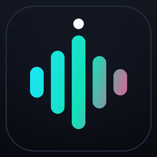
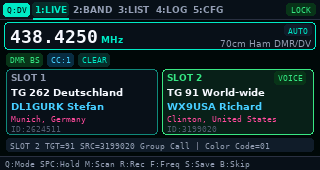
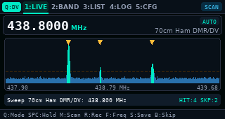
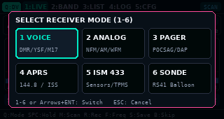
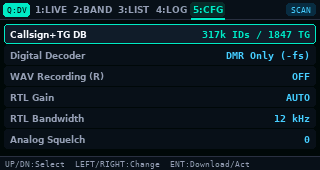

<div align="center">
  
  <h1>ZeroWave</h1>
  <p>
    <strong>2m/70cm All-Mode RTL-SDR Scanner, Digital Voice &amp; Telemetry Suite for the M5Stack Cardputer Zero</strong>
  </p>
  <p>
    <a href="LICENSE">
      
    </a>
    
    
    
  </p>
</div>

---

**ZeroWave** turns your **M5Stack Cardputer Zero** + USB **RTL-SDR** stick into a pocket-sized **2m/70cm all-mode RF scanner and digital voice receiver**. It renders directly to the `320×170` RGB565 framebuffer, reads the full TCA8418 keyboard (Normal / Shift / Sym / Fn layers), and bundles Cortex-A53 (`-O3`) optimized native decoders for smooth real-time audio on the Raspberry Pi CM0.

## 📸 Screenshots

<table>
  <tr>
    <td align="center" width="50%">
      <strong>1. Live DMR Dual-Slot + Callsign DB</strong><br /><br />
      
    </td>
    <td align="center" width="50%">
      <strong>2. Wideband FFT Spectrum Sweep</strong><br /><br />
      
    </td>
  </tr>
  <tr>
    <td align="center" width="50%">
      <strong>3. Quick-Mode 2×3 Switcher (<code>Q</code>)</strong><br /><br />
      
    </td>
    <td align="center" width="50%">
      <strong>4. Settings &amp; Callsign/TG DB Downloader</strong><br /><br />
      
    </td>
  </tr>
</table>

## 📡 6 Receiver Modes (Press `Q`)

1. **`VOICE` (Digital Voice):** DMR (2-Slot BS/MS), YSF (C4FM), D-STAR, M17 (Codec2), dPMR, NXDN48/96, P25 Ph1/Ph2, DMR/P25 Trunking, and Auto-Detect (`-fa`) via Cortex-A53 optimized `dsd-fme`. Hybrid `AUTO` wideband FFT peak-finder + `LIST` cluster-RSSI fast scanner + `TUNER` manual mode.
2. **`ANALOG` (FM / AM):** NFM (2m/70cm Relais, PMR446, Marine, Freenet), AM (Aviation 118–137 MHz), and WFM (FM Broadcast) with live spectrum `AUTO` band-sweep & direct `TUNER`.
3. **`PAGER` (POCSAG / FLEX):** Live POCSAG 512/1200/2400 & FLEX pager feed via `multimon-ng` (DAPNET `439.9875 MHz` preset included).
4. **`APRS`:** Live AFSK1200 packet radio feed (`144.800 MHz` EU & `145.825 MHz` ISS presets).
5. **`ISM 433`:** Live 433/868 MHz weather station, thermometer & TPMS sensor cards via `rtl_433`.
6. **`SONDE`:** 400–406 MHz weather balloon spectrum sweep & Vaisala RS41 live telemetry via `rs41mod`.

## ✨ Key Features

- **Offline Callsign & Talkgroup DB Downloader (`5:CFG`):** One-click download of RadioID.net (~317k DMR IDs: Callsign, Name, City, Country) + BrandMeister Talkgroups into a fast local SQLite database.
- **Zero-Drop Live WAV Recording & Playback (`R` & `4:LOG`):** Seamless PipeWire `pw-record` capture to `~/ZeroWave_Recordings/` without interrupting scanning or audio playback, playable directly on the Cardputer speaker.
- **Separate Per-Mode Logs (`4:LOG`):** Independent persistent logs for `VOICE`, `ANALOG`, `PAGER`, `APRS`, `ISM433`, and `SONDE`.
- **Native Cardputer Zero Controls:** `Q` Mode Grid, `1`–`5`/`Tab` Tabs, `Space` Hold/Pause, `M` Scan/Tuner, `F` Direct Freq (`SYM+.` decimal), `R` Record, `S` Save Favorite, `B` Skip, `X` Blacklist, `FN+A/S/D` Mute/Volume, and 3-second `ESC` hold exit overlay.

## 🚀 Installation

Install directly from the **Cardputer Zero AppStore** (search `ZeroWave` or Share Code **`ZWAV`**), or build locally:

```bash
./build_deb.sh
sudo apt install ./build/zerowave_1.0.0_arm64.deb
```

## 📄 License

Licensed under the [**GNU General Public License v3.0 or later**](LICENSE) (`GPL-3.0-or-later`).
